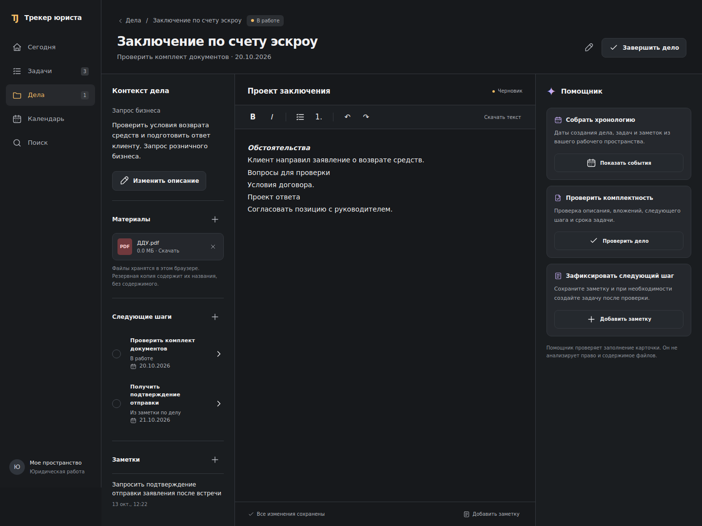

# Трекер юриста

Личное рабочее пространство для дел, задач, заключений и событий. Статическое веб-приложение, которое работает без сборки.

## Темный интерфейс по референсу

Графитовые поверхности, янтарные действия, три колонки внутри дела: контекст, редактируемый черновик и помощник. На телефоне содержимое дела переключается между вкладками «Заключение», «Контекст» и «Помощник».

Навигация: «Сегодня», «Задачи», «Дела», «Календарь», «Поиск». Отдельных разделов «Сессии», «Документы», «Еще» и таймера нет. Существующие проекты показываются как дела, без изменения ключей хранения.



## Действия

- Создание и редактирование дел и задач, завершение и возвращение в работу.
- Черновик с форматированием, автоматическим сохранением и экспортом в текст.
- Заметки по делу; создание задачи из заметки после проверки названия и срока.
- Добавление файлов до 20 МБ, скачивание и подтверждаемое удаление.
- Календарь: события, сроки, переход между месяцами и экспорт в ICS.
- Поиск по делам, задачам, тексту заключений и заметкам. Быстрый поиск: Ctrl/Cmd+K.
- Существующий недельный план приоритетов доступен с главной страницы.
- Синхронизация доступна по кнопке облака. Экспорт и резервная копия находятся на странице задач.

Помощник составляет хронологию по сохраненным датам и проверяет заполнение карточки. Он не выполняет юридический анализ и не читает содержимое приложенных файлов.

## Данные

Существующие ключи localStorage и путь облачной синхронизации сохранены. Черновик хранится в записи дела, заметки и задачи сохраняются в соответствующих коллекциях. Содержимое вложенных файлов хранится локально в IndexedDB этого браузера. Облачная синхронизация и JSON-копия включают только метаданные файлов: перенос содержимого файлов на другое устройство в этой версии не реализован. Ограничение видно в интерфейсе материалов.

## Проверки

```sh
node tests/smoke.cjs
node tests/sync.cjs
node tests/sync-recovery.cjs
node tests/calendar-cloud-bridge.cjs
```

Для проверки интерфейса требуется Playwright и установленный Chromium:

```sh
npm install --prefix /tmp/tracker-test-deps playwright@1.51.1
NODE_PATH=/tmp/tracker-test-deps/node_modules TEST_BROWSER_EXECUTABLE=/path/to/chromium node tests/reference-workspace.cjs
```

Тест самостоятельно поднимает локальный сервер. Он проверяет основные операции, сохранение после перезагрузки, файлы, форматирование, разделение задач разных дел, поиск, календарь, резервные копии и отсутствие горизонтальной прокрутки на ширинах 320, 360, 390, 430, 768, 1024 и 1440 пикселей. Реальные скриншоты сохраняются в `/tmp/tracker-reference-qa` или в `TEST_SCREENSHOT_DIR`.

Автоматическая проверка GitHub Actions выполняет те же сценарии и сохраняет скриншоты как артефакт. Статические проверки CSP и безопасности остаются отдельным заданием.

Дополнительные проверки моделируют обмен между двумя браузерами с изолированным тестовым API: существующие данные, черновик, заметки, задачи, очередь без сети и календарь. Настоящие пользовательские записи этими тестами не изменяются. Проверка мобильных полей контролирует размер шрифта от 16 px и сохранение масштаба viewport при фокусе. Возможность ручного увеличения сохранена.
